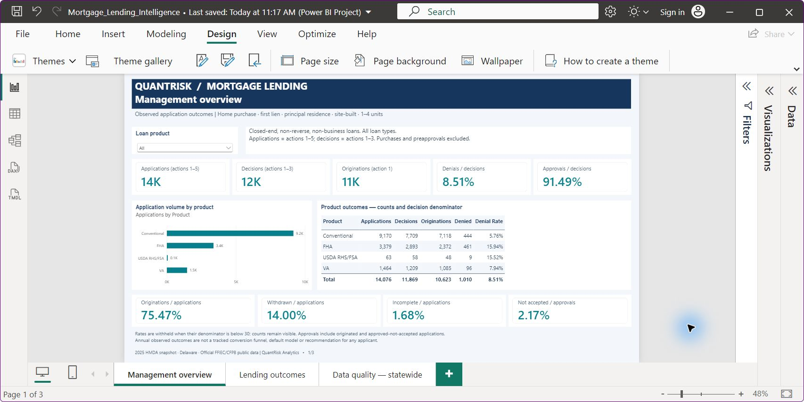
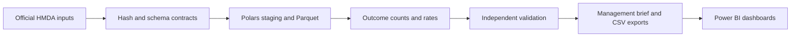

# Mortgage Lending Decision Intelligence & Automated Reporting

**From official mortgage application records to transparent management reporting.**

Mortgage operations teams need to distinguish applications, decisions and originations before comparing lending outcomes. This QuantRisk Analytics portfolio project turns the **2025 HMDA Delaware snapshot** into a reproducible Python pipeline and three Power BI pages with explicit denominators, lender/product filters and data-quality evidence.

It complements [European Bank Risk Intelligence](https://github.com/ehab-salama-analytics/eu-bank-risk-intelligence): Project #1 monitors institutions; Project #2 analyses application-level populations and automates management reporting. Both are historical proofs of capability, not deployed production services.



*Genuine Power BI capture, 28 October 2026. All products selected. Official FFIEC/CFPB public data; calculations and report by QuantRisk Analytics. Large cards abbreviate counts; the table shows exact values.*

## What the analysis shows

The selected cohort covers home-purchase, first-lien, principal-residence, site-built properties with 1–4 units, excluding reverse, open-end and business-purpose loans. All loan types are retained.

| Measure | Numerator / denominator | Result |
|---|---|---:|
| Applications | Actions 1–5 | 14,076 |
| Decisions | Actions 1–3 | 11,869 |
| Originations | Action 1 | 10,623 |
| Denial rate | 1,010 denied / 11,869 decisions | 8.51% |
| Approval rate | 10,859 originated or approved-not-accepted / 11,869 decisions | 91.49% |
| Origination share | 10,623 originated / 14,076 applications | 75.47% |

These are annual observed outcomes, not a tracked conversion funnel or unique borrowers. Purchased loans and standalone preapproval actions do not enter the application or decision rates. Rates with denominators below 30 are withheld while counts remain visible; this is a project display rule, not a statistical or privacy guarantee.

## What was built

- **Preserved official inputs:** 55,183 records, 99 fields and 558 lender LEIs; hash-pinned source and lender reference.
- **Reproducible analytics:** lossless string staging, typed numeric/status fields, explicit cohort exclusions, Parquet outcome counts, rates and field coverage.
- **Independent controls:** raw-CSV reconstruction, official action count/amount reconciliation, lender-reference checks, CSV round trips and model-grain checks.
- **Automated local reporting:** a generated management brief, manifests and report-ready CSVs.
- **Three Power BI pages:** Management overview, Lending outcomes and Data quality — statewide. [View the gallery and demo guide](docs/dashboard.md).



Python, Polars, Parquet and Power BI provide the implemented stack. Scheduled refresh, report distribution, pricing analysis and adjusted lender comparisons remain future work.

## Evidence and reproduction

The publication copy was rebuilt from the preserved raw inputs on **28 October 2026**. Validation evidence is included under [docs/evidence](docs/evidence/). Desktop checks covered statewide totals, single/multiple product selections, lender-product filters, small groups, empty intersections, resets and statewide-quality independence. These are internal controls, not external certification.

```sh
python -m venv .venv
python -m pip install -r requirements-lock.txt
python -X utf8 src/run_pipeline.py all
```

Activate the virtual environment before installing and running, or use its Python executable explicitly. Download the official source files first using the [reproduction guide](docs/reproduction.md). Raw and generated datasets and the packaged PBIX are not distributed. The editable PBIP definitions are included: set `DataFolder` to your generated Power BI CSV directory before refreshing.

| Resource | Purpose |
|---|---|
| [Project charter](PROJECT_CHARTER.md) | Delivered scope and boundaries |
| [Source decision](docs/data_source_decision.md) | Acquisition, snapshot version and limitations |
| [Source reconciliation](docs/source_reconciliation.md) | Official totals and lender reference |
| [Reporting methodology](docs/outcome_reporting.md) | Grain, denominators and display rules |
| [Validation](docs/validation.md) | Executed controls and remaining limitations |
| [Dashboard guide](docs/dashboard.md) | Screenshots and a short demonstration route |
| [Power BI project](power_bi/README.md) | Model, measures and refresh instructions |
| [Reproduction](docs/reproduction.md) | Inputs, dependencies and execution |

## Interpretation and limitations

HMDA describes US mortgage lending/application outcomes, **not subsequent defaults or repayment performance**. This project does not score applicants or recommend individual approval/denial decisions. Descriptive lender differences are not adjusted performance rankings; demographic patterns cannot establish causation or legal conclusions about discrimination. US evidence does not establish Luxembourg mortgage-market conditions.

Public-data modifications, exemptions and missingness constrain analysis. Identical public rows are retained because they cannot safely be treated as duplicate loans. The unresolved LTV export alias is excluded from typed LTV and leverage metrics. [Read the source and field notes](docs/initial_schema_and_kpi_plan.md).

## About QuantRisk Analytics

**ANALYSE → AUTOMATE → TRAIN**

This portfolio demonstrates analytical reporting, reproducible automation and explainable handover for a proposed analytics and training consultancy. Technical evidence is not commercial traction. The project is independent of the CFPB and FFIEC and is not endorsed by them. Official source links and acquisition limitations are documented; no ownership of the underlying HMDA data is claimed.
