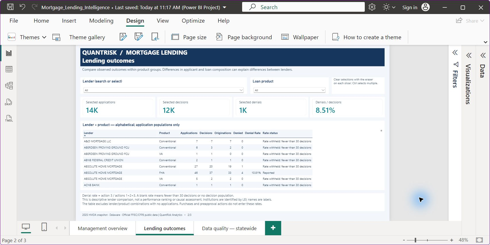
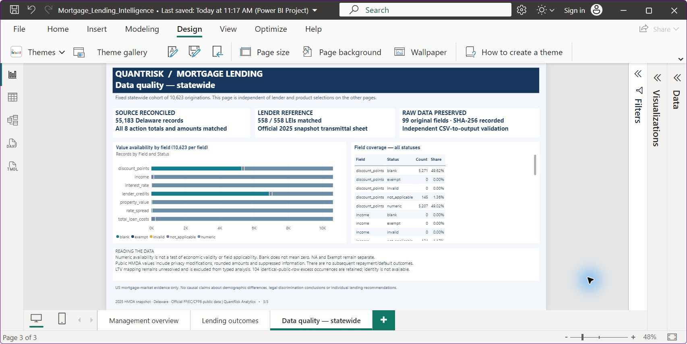

# Dashboard gallery and demonstration

Three pages were built and checked in Power BI Desktop on 28 October 2026. These are genuine captures of the local report. Editable definitions are in [power_bi](../power_bi/README.md); raw data, local caches and PBIX binaries are excluded from the repository.

## Management overview

Begin with all products: 14,076 applications, 11,869 decisions and 10,623 originations. Select Conventional to inspect 7,709 decisions and 444 denials (5.76%). Multiple selections recompute rates from summed counts rather than averaging product percentages. Exact counts appear in the table.

## Lending outcomes

Filter a lender and product, inspect the decision denominator and rate status, and clear selections with the slicer erasers. Small groups retain counts but withhold rates. The alphabetical table supports descriptive exploration, not a lender performance ranking. Scroll for additional rows.

## Data quality — statewide

This page remains fixed at 10,623 cohort originations regardless of lender/product selections elsewhere. Inspect numeric, blank, NA, Exempt and invalid statuses by field. Source audit figures cover the full Delaware extract. Scroll the table for all field/status combinations.

## Reading rules

Applications use actions 1–5; decisions use 1–3; originations use 1. Approval includes originated and approved-not-accepted applications. Annual outcomes are not a tracked funnel. A blank rate does not mean zero. Field coverage is not evidence that every reported value is correct.

Desktop acceptance evidence: [recorded checks](evidence/power_bi_desktop_validation.json). Bar cross-highlighting, PDF export and Service deployment were not tested.
